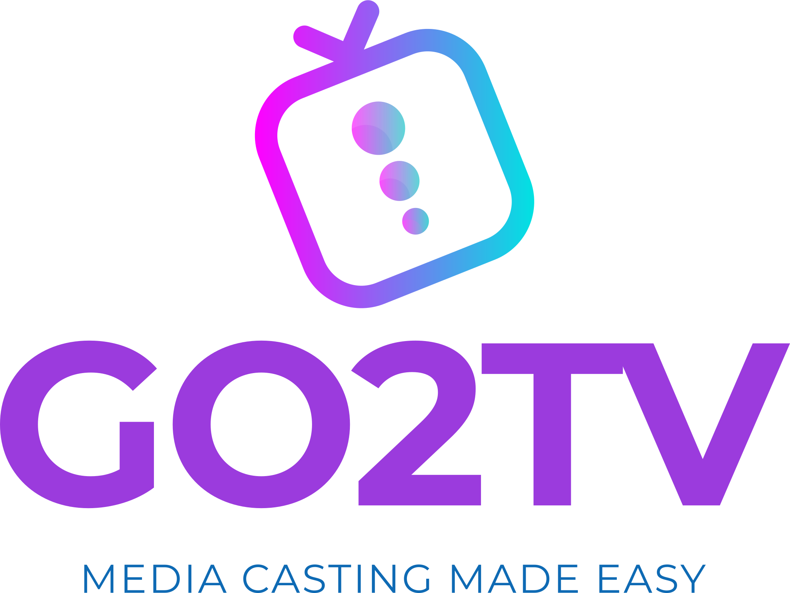
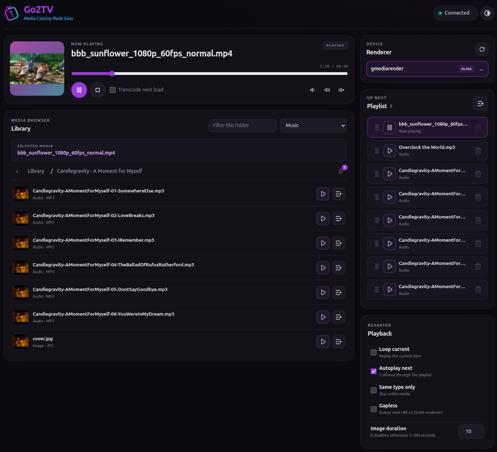

<br/>
<p align="center">

</p>
<br/>
<div align="center">
<p>

[](https://github.com/alexballas/Go2TV/releases/latest)
[](https://github.com/alexballas/go2tv/actions/workflows/go.yml)
</p>
Cast media files to Smart TVs and Chromecast devices.
</div>

---

## What is Go2TV?

Go2TV lets you play video, audio, and image files on your Smart TV or Chromecast device directly from your computer or phone. It works with:

- **Smart TVs** - Samsung, LG, Sony, and others that support DLNA/UPnP
- **Chromecast** - Google Chromecast, Chromecast with Google TV, and compatible devices
- **Apps** - BubbleUPnP, GMediaRender, and other media receiver apps

No need to copy files to a USB drive or set up a media server. Just select your file, pick your device, and play.

## Features

- **Internet radio** - Browse Radio Browser stations by name, genre, or country; save favorites and cast to DLNA or Chromecast
- **Auto-discovery** - Automatically finds Smart TVs and Chromecast devices on your network
- **Transcoding** - Converts incompatible video formats on-the-fly (requires FFmpeg)
- **Subtitles** - Supports external SRT/VTT/ASS/SSA files and embedded MKV subtitles
- **Seek support** - Jump to any position in the video
- **Torrent playback** - Paste a magnet link or open a .torrent, choose a media file, and cast while downloading. Missing ranges download on demand, including FFmpeg input seeks.
- **Playlist playback** - Single-file and multi-file playlists with add/remove/reorder/select support
- **Loop and auto-play** - Loop the current file or auto-play through the playlist
- **DLNA Gapless Playback** - Supported for DLNA devices
- **RTMP Server** - Cast live streams from OBS directly to Chromecast (requires FFmpeg)
- **Cast Desktop (experimental)** - Cast desktop as a live stream to DLNA or Chromecast devices (requires FFmpeg)
- **Web UI (server mode)** - Browse media roots, tune in to internet radio and control casting from any browser on your network
- **GUI and CLI** - Use the graphical interface or command line

---

## Screenshots

**GUI Mode**


**CLI Mode**


**Web UI (Server Mode)**

<picture>
  <source media="(prefers-color-scheme: dark)" srcset="assets/webui-dark.png">
  <source media="(prefers-color-scheme: light)" srcset="assets/webui-light.png">
  
</picture>

---

## Installation

**macOS**: Install with Homebrew:

```bash
brew install --cask go2tv
```

**Linux**: Install from [Flathub](https://flathub.org/en/apps/app.go2tv.go2tv):

```bash
flatpak install flathub app.go2tv.go2tv
```

Or **download the latest release** from the [releases page](https://github.com/alexballas/Go2TV/releases/latest).

- **Windows GUI**: Download `go2tv_vX.Y.Z_windows_amd64.zip`, extract, and run `go2tv.exe`
- **Windows CLI**: Download `go2tv_vX.Y.Z_windows_amd64_lite.zip`, extract, and run `go2tv-lite.exe`
- **macOS**: Download `go2tv_vX.Y.Z_macOS_amd64.zip` (Intel) or `go2tv_vX.Y.Z_macOS_arm64.zip` (Apple Silicon), extract, and run the app
- **Linux**: Download `go2tv_vX.Y.Z_linux_amd64.zip` (or appropriate arch), extract, and run `go2tv`
- **Android**: Download `go2tv_vX.Y.Z.apk` for the arm64 build with bundled FFmpeg transcoding

For release downloads, Go2TV is a single executable with no installation required. Just download and run.

Windows releases are not code-signed, so SmartScreen may show "Windows protected your PC" on
first run. Click **More info**, then **Run anyway**.

On Android, opening the downloaded APK asks you to allow installs from that app (your
browser or file manager). Allow **Install unknown apps** for it, then go back and install.

### Optional: FFmpeg for Transcoding

For maximum compatibility with all devices and file formats, install [FFmpeg](https://ffmpeg.org/download.html). Go2TV will automatically use it when needed.
When transcoding is enabled, Go2TV probes available GPU H.264 encoders first and falls back to `libx264` if hardware encoding is unavailable or fails at startup.

- **Linux**: `sudo apt install ffmpeg` or equivalent for your distro
- **macOS**: `brew install ffmpeg`
- **Windows**: `winget install Gyan.FFmpeg`, or download from [ffmpeg.org](https://ffmpeg.org/download.html) and add it to `PATH`
- **Flatpak**: FFmpeg is bundled automatically
- **Android**: FFmpeg is bundled in the default APK. It is arm64-only and requires Android 9.0+.

If Go2TV can't find FFmpeg, point it at the binary in **Settings → Advanced → ffmpeg Path**
(GUI) or pass `-ffmpeg /path/to/ffmpeg` (CLI).

---

## Usage

### GUI

Select a media file (or drag and drop it onto the main window), pick a device from the list, and click **Play**.

For internet radio, click **Radio…** beside the main media controls. Enter a station name or genre, then press the adjacent search icon or Enter. Choose **Select country** below the search field to filter results, or open **Favorites**. **Popular** clears the search and returns to popular stations in the selected country. **All countries (clear selection)** removes the country filter. Select a station and click **Use station**; choosing a new station stops existing playback, closes the picker, and fills the main URL field. Then choose a device and press the normal **Cast/Play** button. Station icons appear when available and accompany playback artwork. Favorites refresh by UUID, falling back to the saved URL when the directory is unavailable.

Enable the main **Transcode** checkbox when a receiver cannot play the original radio stream. FFmpeg relays stereo AAC audio, including HLS stations. Android bundles FFmpeg; desktop builds need FFmpeg installed. Receivers must support AAC. Direct stations that supply ICY metadata show their current track in the main playback controls; HLS and stations without ICY metadata have no track display.

For torrents, click **Torrent…**, paste a magnet link or open a `.torrent`, and choose
**Use file**. Pick a device and cast immediately. Seeks fetch missing pieces first;
FFmpeg transcoding uses the same seekable source. **Cancel download** stops playback
and removes the temporary cache. Loading another torrent or quitting also removes it.

On Android, the same **Torrent…** flow supports magnets and provider-backed
`.torrent` documents. Torrent files can also be shared or opened from other apps.
Downloads continue in the background until **Cancel download**, even after **Stop**.

#### Playlist

The **Playlist** window lets you add, remove, reorder, and select files. Dragging files onto
the main window replaces the playlist; dragging them onto the Playlist window appends them.
**Next**, **Previous**, and **Auto-Play Next File** follow the playlist order.

### CLI

Run `go2tv -h` for all options.

First, find your device's URL. `go2tv -l` keeps scanning and lists each device
with its URL in brackets; press `q` to quit:

``` console
$ go2tv -l
Scanning devices... (q to quit)

• Living Room TV DLNA [http://192.168.1.100:8060/]
• Kitchen speaker Chromecast [http://192.168.1.50:8009]
```

Pass that URL to `-t`. The addresses below are examples; use the ones `-l`
shows for your devices. Chromecast URLs normally end in `:8009`; DLNA URLs vary
by TV.

Common commands:

``` console
# List available devices
go2tv -l

# Play a local file
go2tv -v movie.mp4 -t http://192.168.1.100:8060/

# Play with subtitles and transcoding
go2tv -v movie.mkv -s movie.srt -tc -t http://192.168.1.100:8060/

# Play a remote file
go2tv -u https://example.com/movie.mp4 -t http://192.168.1.50:8009

# Cast a torrent before download completes (also supported by go2tv-lite)
go2tv -v movie.torrent -torrent-file 0 -t http://192.168.1.100:8060/
go2tv -u 'magnet:?xt=urn:btih:...' -torrent-file 0 -tc -t http://192.168.1.50:8009

# Chromecast compatibility fallback for external captions (requires -tc)
go2tv -v movie.mkv -s movie.srt -tc -burn-subtitles -t http://192.168.1.50:8009

# Stream from another command
yt-dlp -o - "https://youtu.be/..." | go2tv -t http://192.168.1.50:8009

# Transcode with a custom FFmpeg binary
go2tv -tc -ffmpeg /path/to/ffmpeg -v movie.mkv -t http://192.168.1.50:8009
```

Omit `-torrent-file` for torrents containing one media file. For multiple media
files, omitting it lists their indexes. Torrents work in desktop GUI, mobile,
CLI/TUI, and Web UI. Chromecast automatically renders embedded text captions in
MKV/WebM torrents while downloading; external `-s` captions take precedence.
Use `-no-torrent-subtitles` to disable automatic torrent captions. These flags
also work with `go2tv-lite`.

### Web UI (Server Mode)

Run Go2TV as a web server to browse selected media folders and control casting from a
browser. The Web UI has separate device, playlist, and playback state from the desktop GUI.

Open **Torrent…** in the library to paste a magnet or upload a `.torrent` (up to
4 MiB). Choose a media file, click **Use file**, then **Play** to cast while it
downloads. Progress and **Cancel download** are shared across browsers. Cancel
stops torrent playback and removes its queue item and temporary cache. Loading
metadata leaves the current stream intact; choosing another torrent replaces it.
Server shutdown removes torrent caches. FFmpeg transcoding supports input seeks.

Switch the media browser to **Radio** to search Radio Browser stations by name or genre,
filter by country, or open **Favorites** and **Recent**. Press play on a station to cast
it; without a selected renderer, the station waits for **Play**. The player shows the
station logo, a **Live** badge, and the current track when the station announces it.
Stations play outside the playlist. **Transcode next load** re-encodes stations to AAC for
receivers that cannot play the original codec. Favorites and recent stations are shared
by every browser and saved in `go2tv/webui-radio.json` under the user configuration
directory, separately from the desktop GUI's favorites.

From the GUI, open **Settings → Remote Web Session…**, add media folders, choose local or
LAN access, and start the session.

For headless use, pass `-server` and at least one `-media-root`:

``` console
go2tv -server -media-root /path/to/Media
```

Use `-ffmpeg /path/to/ffmpeg` when FFmpeg is not available on `PATH`. CLI,
go2tv-lite, and the Web UI verify and use the supplied binary.

The default URL is `http://127.0.0.1:9666/`. Repeat `-media-root` to expose multiple
directories:

``` console
go2tv -server \
  -media-root /path/to/Movies \
  -media-root /path/to/Music \
  -media-root "/path/to/TV Shows"
```

For LAN access, set a non-loopback `-listen` address and allow each browser origin:

``` console
go2tv -server \
  -listen 0.0.0.0:9666 \
  -allowed-origin http://192.168.1.20:9666 \
  -media-root /path/to/Media
```

> LAN mode uses HTTP without TLS. Use it only on trusted networks.

### Subtitles

Desktop GUI **Automatic** subtitles prefer a matching sidecar: a subtitle file
next to the video with the same name (`.srt`, `.vtt`, `.ass`, then `.ssa`).
Without a sidecar, DLNA leaves embedded subtitles to the TV during direct playback; with transcoding, it burns the first supported local
embedded track. Chromecast selects the first supported embedded text track for
receiver captions, or the first supported text or bitmap track for burn-in.
DLNA serves sidecars and explicitly selected embedded text tracks as SRT without
transcoding. Unreadable automatic tracks never block playback.

**Automatic torrent subtitles** controls embedded torrent text subtitles.
External SRT/VTT/ASS/SSA captions use the Chromecast receiver during direct and
transcoded playback; transcoded seeks shift captions to the new stream start. Enable
**Playback → Burn Chromecast Subtitles (Compatibility Fallback)** for a compatibility fallback requiring
transcoding, including automatic embedded MKV/WebM torrent captions. Desktop GUI
and mobile offer the same fallback in **Settings → Playback**. DLNA burns selected
subtitles and automatic embedded torrent text subtitles during transcoding.
Embedded torrent burning renders captions in short windows as playback advances,
so startup does not require the entire track or video. The current caption window
and its timing lookahead still need verified torrent pieces; missing pieces can
delay playback. External subtitles take priority. Embedded torrent captions use
their original ASS/SSA styles, positioning, animation and attached fonts when
burned during transcoding. Local embedded ASS/SSA tracks are also burned directly
from their container, preserving attached fonts. External ASS/SSA files preserve
their styles and can use font files alongside the subtitle file. Receiver WebVTT
captions retain simplified formatting. Local bitmap subtitles (PGS, DVD, DVB,
XSub) require transcoding and are burned into the video; Chromecast also requires
**Burn Chromecast Subtitles**. Bitmap captions cannot be served as SRT or WebVTT.
FFmpeg must include `overlay` and `scale2ref` for bitmap burn-in, and `subtitles`,
`overlay`, and `scale2ref` filters and PNG support for embedded torrent burn-in.

### RTMP Streaming (Chromecast only)

Select a Chromecast, enable **RTMP Server**, and click **Play**. Use the displayed URL in
OBS or other streaming software. Requires FFmpeg.

### Cast Desktop (Experimental)

Select a DLNA or Chromecast device, enable **Cast Desktop (experimental)**, and click **Cast**.
Requires FFmpeg and is not supported on audio-only devices.

---

## Supported File Types (GUI)

mp4, avi, mkv, mpeg, mov, webm, m4v, mpv, mp3, flac, wav, jpg, jpeg, png

The CLI accepts any file type.

---

## Companion Project: mcp-beam MCP Server (Powered by Go2TV)

[mcp-beam](https://go2tv.app/mcp-beam/) is a companion MCP server (stdio transport) built on top of Go2TV core packages.

It lets MCP clients discover Chromecast and DLNA/UPnP devices, cast local files or remote
URLs, and stop playback. For direct control, use the Go2TV GUI or CLI.

---

## Troubleshooting

### Device not listed

- Put the computer and the TV/Chromecast on the same network. Guest Wi-Fi, separate
  2.4/5 GHz networks on some routers, and different subnets block discovery.
- Disconnect from any VPN; it can route discovery traffic away from your local network.
- Turn the TV fully on and check that its DLNA/media-sharing setting is enabled
  (the name varies by brand).
- Allow Go2TV through your firewall (see below).
- `go2tv -l` keeps scanning; give slow devices a few seconds to appear.

### Device listed but playback fails

- Try again with **Transcode** enabled (`-tc` in the CLI). It requires FFmpeg.
- Check the firewall's TCP port range below; the TV fetches media from your computer.

### Firewall Configuration

If you're behind a firewall, allow inbound traffic from devices on your local network:

- `3339-3438/udp` for DLNA/UPnP device discovery
- `3500-4499/tcp` for the local HTTP media server used by DLNA and Chromecast playback

---

## Notes

**Chromecast receiver**

Go2TV uses a custom Chromecast receiver hosted at https://cast-receiver.go2tv.app/. It is not part of this open-source repository and is not currently published. It renders external WebVTT captions and progressive embedded text captions from MKV/WebM torrents, alongside Go2TV branding.

---

## Building from Source

**Requirements**:

- Go 1.26.9 or later (Go 1.27 requires 1.27.2 or later)
- A C compiler and the GUI toolkit headers:
  - **Debian/Ubuntu**: `sudo apt install gcc pkg-config xorg-dev libwayland-dev libxkbcommon-dev libegl-dev libpipewire-0.3-dev`
  - **macOS**: `xcode-select --install`
  - **Windows**: MSYS2 UCRT64 with `mingw-w64-ucrt-x86_64-gcc`, `mingw-w64-ucrt-x86_64-cppwinrt`, and `mingw-w64-ucrt-x86_64-pkg-config`

``` console
git clone https://github.com/alexballas/go2tv
cd go2tv
make build
```

The binary is written to `build/go2tv`. AppImage, Android, and Docker builds are
covered in [BUILDING.md](BUILDING.md).

---

## Author

Alexandros Ballas <alex@ballas.org>

## License

MIT

Artifacts that bundle FFmpeg inherit the bundled FFmpeg build's license obligations. Source-built Android APKs and default bundled AppImages use GPL FFmpeg builds. The legacy Android binary-download target uses an LGPL FFmpeg build.
